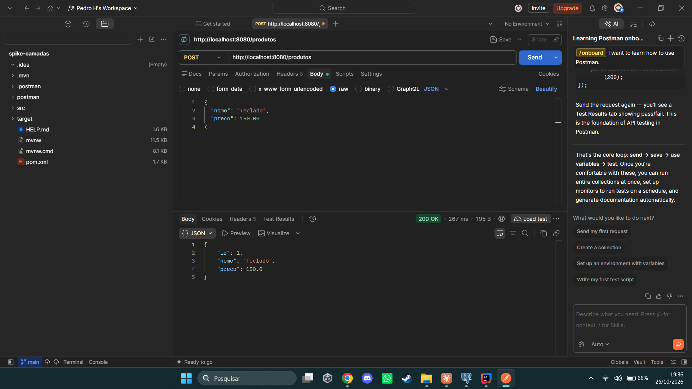
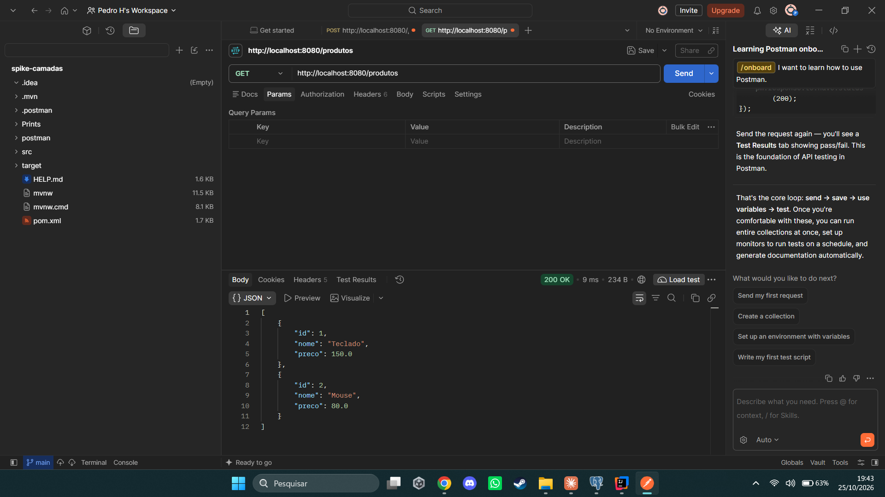
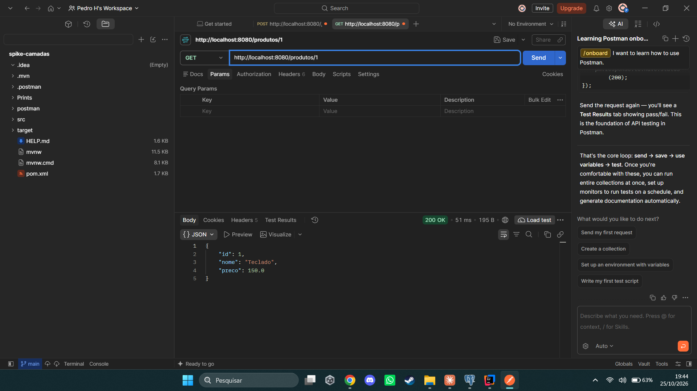
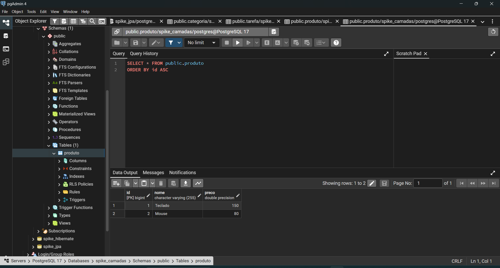

# Integração das camadas

Exemplo de cadastro e consulta de `Produto` com Spring Boot e PostgreSQL,
separado em Controller, Service, Repository e Entity.

## Tecnologias
- Java 21, Spring Boot 4.1.2
- Spring Web, Spring Data JPA, PostgreSQL 17

## Como rodar
1. Criar o banco `spike_camadas` no PostgreSQL.
2. Definir a variável de ambiente `DB_PASSWORD` com a senha do postgres.
3. Rodar a classe `SpikeCamadasApplication`.
4. A API sobe em `http://localhost:8080`.

## Endpoints
| Método | URL | O que faz |
|--------|-----|-----------|
| POST | /produtos | Cadastra um produto |
| GET | /produtos | Lista todos |
| GET | /produtos/{id} | Busca por id |

## Papel de cada camada
- **Entity (`Produto`)**: representa a tabela do banco. Cada objeto é uma linha.
- **Repository (`ProdutoRepository`)**: acessa o banco. Com o JpaRepository, salvar e buscar já vêm prontos.
- **Service (`ProdutoService`)**: guarda as regras de negócio (ex.: preço não pode ser negativo).
- **Controller (`ProdutoController`)**: recebe as requisições HTTP e chama o Service.

Fluxo: Postman > Controller > Service > Repository > Banco, e a resposta volta pelo mesmo caminho.

## Evidências

