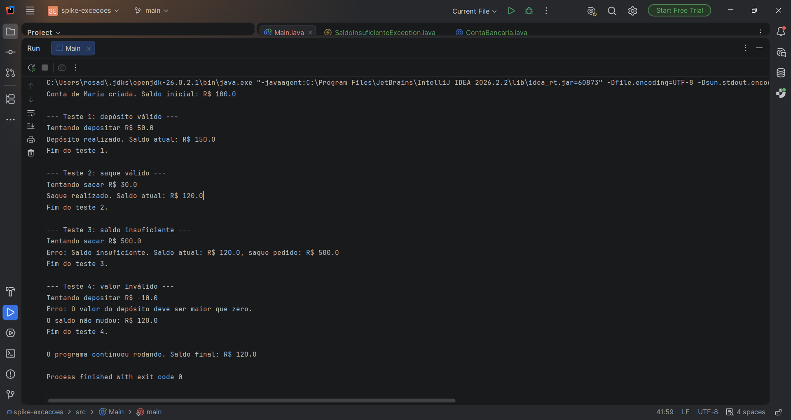

# Tratamento de Exceções

Aplicação Java simples (sem banco e sem Spring) que simula uma conta bancária
e trata erros de regra de negócio com exceções.

## Como rodar
Abra a pasta no IntelliJ e rode a classe `Main`.

## Classes
- `ContaBancaria`: guarda titular e saldo, com os métodos `depositar` e `sacar`.
- `SaldoInsuficienteException`: exceção personalizada, lançada quando o saque é maior que o saldo.
- `Main`: executa 4 testes (2 que funcionam e 2 que dão erro).

## Erros tratados
| Situação | Exceção | Mensagem |
|----------|---------|----------|
| Saque maior que o saldo | `SaldoInsuficienteException` (personalizada) | `Saldo insuficiente. Saldo atual: R$ 120.0, saque pedido: R$ 500.0` |
| Depósito ou saque com valor zero ou negativo | `IllegalArgumentException` | O valor do depósito deve ser maior que zero. |

## Como funciona
- `throw`: lança a exceção quando a regra é quebrada.
- `throws`: na assinatura do método, avisa que ele pode lançar a exceção.
- `try`: bloco com o código que pode dar erro.
- `catch`: captura o erro e mostra a mensagem, sem encerrar o programa.
- `finally`: roda sempre, com ou sem erro.

## Evidência
